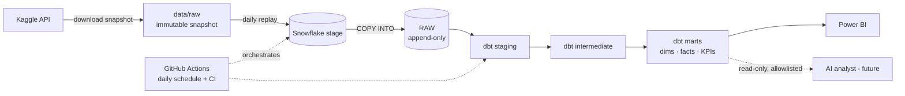

# Olist Analytics Platform

An end-to-end analytics engineering project on the
[Olist Brazilian E-Commerce dataset](https://www.kaggle.com/datasets/olistbr/brazilian-ecommerce)
(~100k orders, 2016–2018). It's built like a production platform: immutable raw data,
layered dbt models with explicit grain, data-quality tests, CI, a BI layer that
reconciles with the warehouse and, later, a read-only AI analyst.

> **Status:** Phase 2 done: Olist snapshot loaded into Snowflake RAW and reconciled. See [docs/PROJECT_STATUS.md](docs/PROJECT_STATUS.md).

## Architecture



Raw-layer rules (all VARCHAR, load metadata, audit table) are in [ADR 0002](docs/adr/0002-raw-layer-conventions.md).
The daily-ingestion and orchestration design is in
[ADR 0001](docs/adr/0001-daily-ingestion-and-orchestration.md).

## Repository layout

```
enterprise_platform/
├── ingestion/olist_ingest/   # Python: download, profiling, Snowflake load (later: replay)
├── data/                     # local only, gitignored
├── docs/                     # inventory, ADRs, findings, status
├── infra/snowflake/          # database, roles, warehouse SQL (run by an admin)
├── transform/                # (Phase 3) dbt project
├── bi/                       # (Phase 11) Power BI .pbip project
└── .github/workflows/        # (Phase 10) CI + daily pipeline
```

Folders marked with a phase are created when that phase starts.

## Quickstart (Windows, PowerShell)

```powershell
cd C:\Users\costa\workspace\enterprise_platform
python -m venv .venv
.\.venv\Scripts\Activate.ps1
pip install -e ".[dev]"

Copy-Item .env.example .env        # then paste your Kaggle token into .env
python -m olist_ingest.download    # -> data/raw/olist/snapshot_date=YYYY-MM-DD/
python -m olist_ingest.profiling   # -> docs/data_inventory.md

# Snowflake (after infra/snowflake 01-06 and the SNOWFLAKE_* values in .env)
python -m olist_ingest.snowflake_conn   # connection + privilege smoke test
python -m olist_ingest.load            # PUT + COPY INTO OLIST_RAW.OLIST, reconciled -> docs/phase2_load_reconciliation.md
```

## Conventions

- **Snapshots are immutable.** New data means a new dated folder, never an edited one.
- **One source registry** ([config.py](ingestion/olist_ingest/config.py)) drives profiling,
  loading and replay.
- **Secrets** live in `.env` (gitignored) and, later, in GitHub Secrets. Nothing secret is committed.
- **Every fact table and mart states its grain** in its YAML documentation.
- **Data-quality issues are documented, never silently dropped.**

## Dataset attribution

Data: *Brazilian E-Commerce Public Dataset by Olist*, published on Kaggle by Olist.
License listed on the dataset page: CC BY-NC-SA 4.0 (verify on the page before publishing).
The raw data is **not** redistributed in this repository; it is downloaded with the
Kaggle API.
