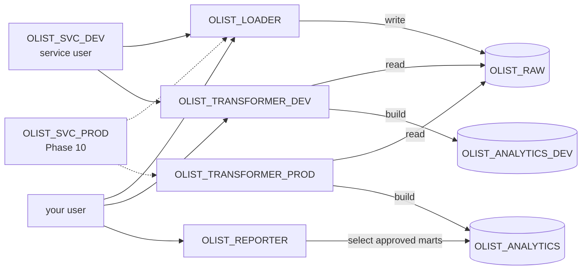

# Snowflake environment (Phase 1)

Infrastructure as versioned SQL. Every script is idempotent (`IF NOT EXISTS`), so
re-running is safe, and the whole environment can be rebuilt in a new account
(for example, when a trial expires) by running 01 → 06 in order.

| Script | Role | Creates |
|---|---|---|
| 01_roles.sql | USERADMIN | 4 workload roles, rolled up to SYSADMIN |
| 02_warehouses.sql | SYSADMIN | 3 XS warehouses, auto-suspend 60 s |
| 03_databases.sql | SYSADMIN | OLIST_RAW (+ OLIST schema), OLIST_ANALYTICS, OLIST_ANALYTICS_DEV (transient) |
| 04_grants.sql | SECURITYADMIN | least-privilege grants |
| 05_users.sql | USERADMIN | OLIST_SVC_DEV service user (key pair) + role grants |
| 06_resource_monitor.sql | ACCOUNTADMIN | 10-credit monthly cap on all Olist warehouses |
| 07_verify.sql | SECURITYADMIN | read-only checks |
| 99_teardown.sql | ACCOUNTADMIN | drops everything (commented out) |

## Access model

Key rules:
- Dev and CI roles have **no privileges on prod**.
- BI only sees marts that dbt explicitly grants.
- Every role rolls up to SYSADMIN.

## Key pair for OLIST_SVC_DEV

Generated locally. The private key never leaves `%USERPROFILE%\.snowflake\keys\` and
is never committed.
